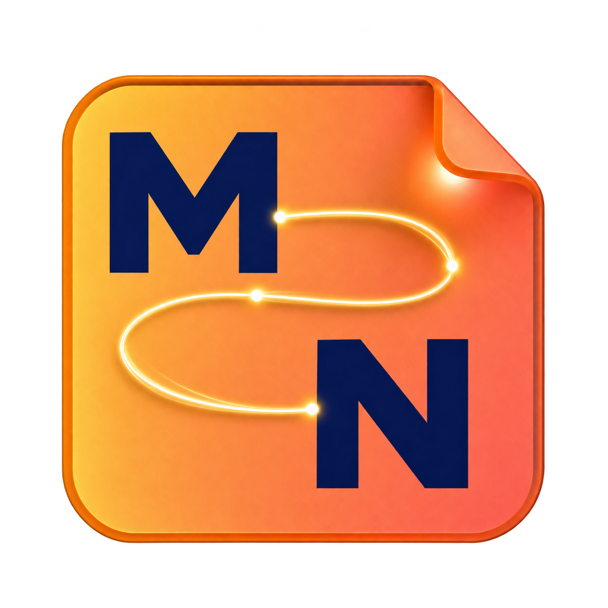
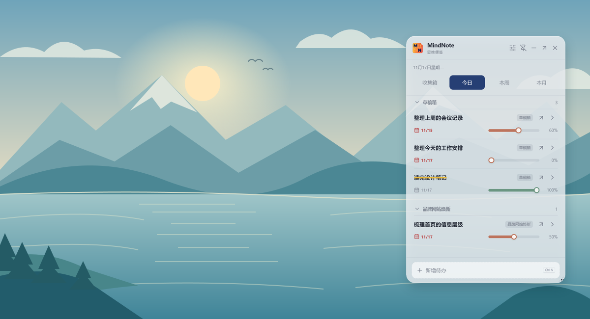
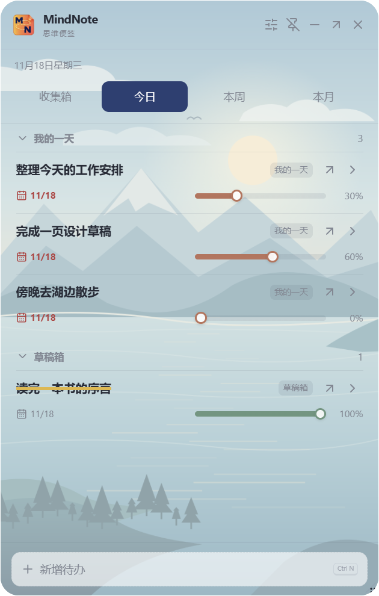
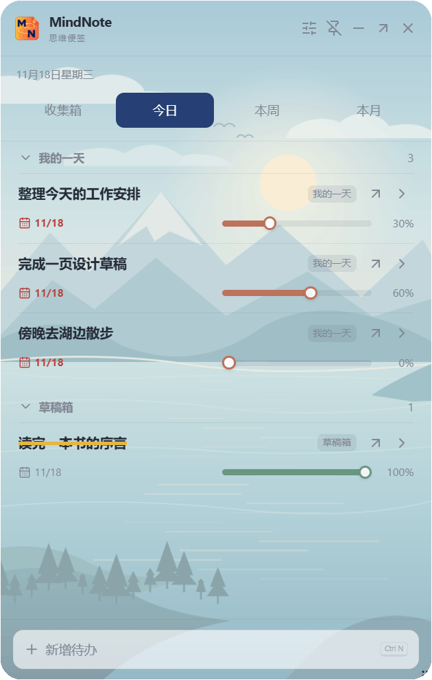

<h1 align="center">MindNote · 思维便签</h1>

在桌面便签记下一件事，把它排进本周，也能点回思维导图查看它属于哪个项目。便签、计划和导图共用同一份进度与备注，离线也会自动保存。

Capture a task on your desktop, schedule it for the week, and jump back to its original mind-map node. Progress and notes stay in sync across views and are saved locally in SQLite.

**下载 V2.0 / Download**　[Mac · Apple Silicon](https://github.com/wang-h-h/MindNote/releases/download/v2.0.0/MindNote-2.0.0-macOS-arm64.dmg)　·　[Mac · Intel](https://github.com/wang-h-h/MindNote/releases/download/v2.0.0/MindNote-2.0.0-macOS-x64.dmg)　·　[Windows x64](https://github.com/wang-h-h/MindNote/releases/download/v2.0.0/MindNote-2.0.0-Setup.exe)

## 桌面便签 / Desktop sticky note

首图由原创壁纸与真实便签截图合成，用于展示桌面布局。The first image combines original wallpaper with a real note capture to illustrate the desktop layout.

启动后先看到这张小便签。它可以置顶、贴边，拖动进度条就能更新事项。点右上角箭头进入完整窗口，查看上周、本周、下周的安排，或回到项目导图。

Pin the note beside your work, drag a slider to update progress, or open the workspace to see three weeks of plans and the project map.

## 给便签换个风景 / Change the scenery

打开 **外观设置 → 背景图片 → 添加背景（或更换背景）**，选择不超过 20 MB 的 PNG、JPEG、GIF 或 WebP。主窗口和便签会一起换背景。开启「减少动效」时，动态风景停在首帧。

In Appearance, choose a background image for both windows. GIFs and animated WebP play in place. Reduce Motion shows the first frame.

|                                 静态山湖 / Still landscape                                  |                                   流云与湖面波纹 / Animated landscape                                    |
| :-----------------------------------------------------------------------------------------: | :------------------------------------------------------------------------------------------------------: |
|  |  |

试用图中的山湖背景 / Try these backgrounds　[静态 PNG](docs/examples/backgrounds/mist-lake.png) · [动态 GIF](docs/examples/backgrounds/mist-lake-animated.gif)

上方两张换背景画面为 Windows 便签实录。Mac 版使用相同的背景设置，见 [Mac 便签实拍 / Mac capture](docs/screenshots/sticky-macos.png)。界面语言为简体中文。

The two background examples are captures of the Windows app. The Mac app has the same background controls. Both use a Simplified Chinese interface.

[安装与版本说明 / Install & release notes](https://github.com/wang-h-h/MindNote/releases/tag/v2.0.0) · [使用指南 / User guide](docs/USER_GUIDE.zh-CN.md) · [三周计划 / Planner](docs/screenshots/week.png) · [项目导图 / Mind map](docs/screenshots/mindmap.png) · [开发 / Development](docs/DEVELOPMENT.md) · [Third-party notices](THIRD_PARTY_NOTICES.md)
