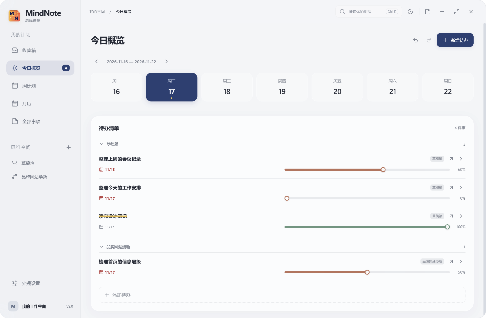
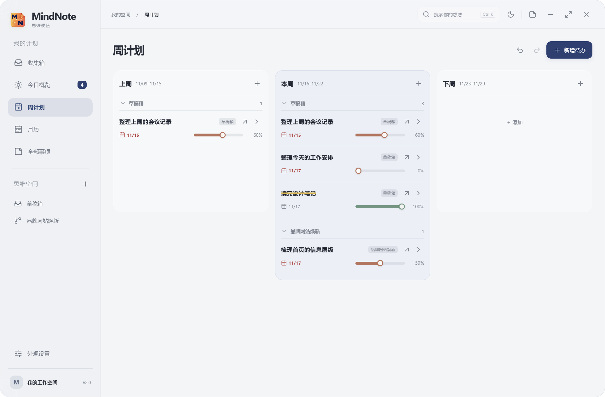
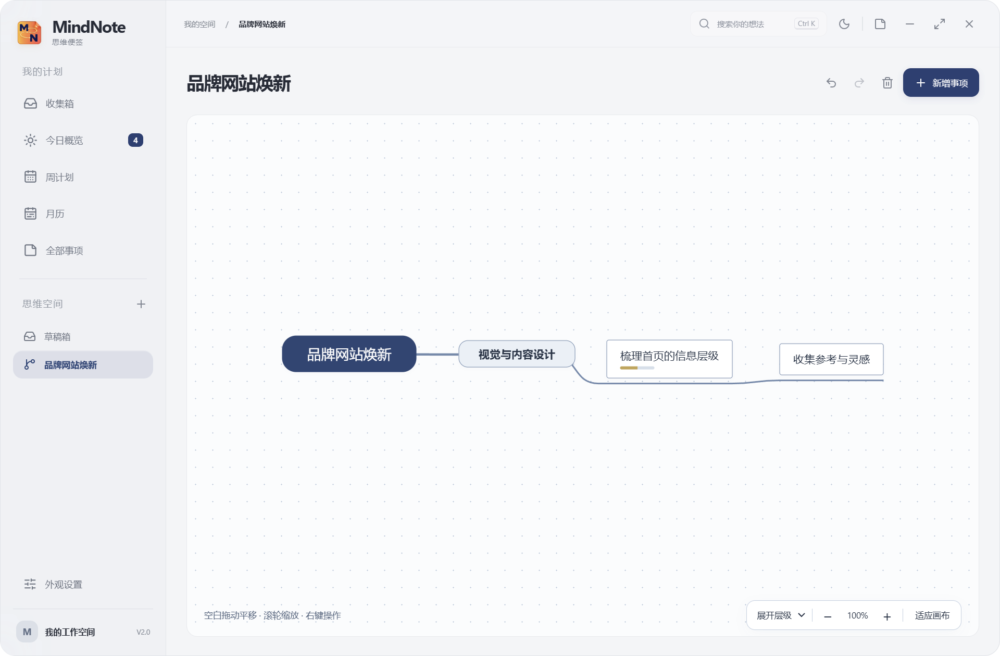
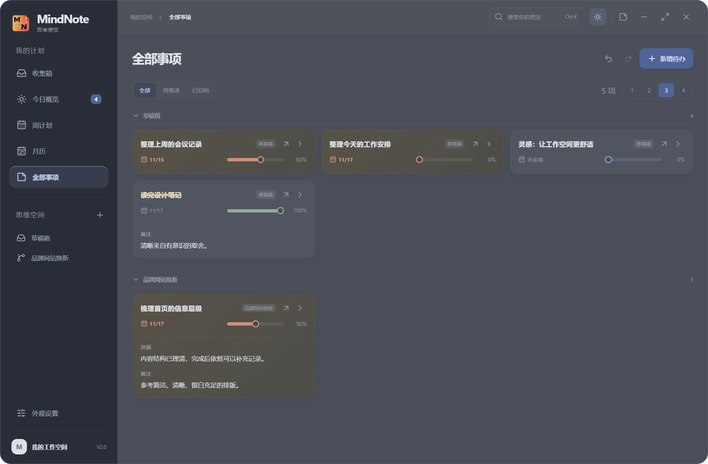

<p align="center">
  
</p>

<h1 align="center">MindNote · 思维便签</h1>

<p align="center">
  <strong>让想法有脉络，让计划有着落。</strong><br />
  Give your ideas structure. Bring your plans into focus.
</p>

<p align="center">
  Windows x64 · V2.0.0 · Local SQLite · Electron + React<br />
  <a href="https://github.com/wang-h-h/MindNote/releases/tag/v2.0.0">下载 / Download</a> ·
  <a href="docs/USER_GUIDE.zh-CN.md">使用说明 / Guide</a> ·
  <a href="docs/RELEASE-v2.0.0.md">V2.0 更新 / What's new</a> ·
  <a href="docs/DEVELOPMENT.md">开发 / Development</a>
</p>

MindNote 将 **桌面便签、待办计划与思维导图** 放进一个 Windows 本地应用。日常从轻巧的透明便签开始，需要梳理项目时打开完整窗口；计划里的事项可以直接定位到导图中的原节点。

MindNote brings **desktop sticky notes, task planning, and mind maps** into one local Windows app. Start with a lightweight transparent note, open the full workspace when you need the bigger picture, and jump from a planned task to its original mind-map node.



## 为什么是 MindNote / What makes it different

| 特色 / Feature                                      | 体验 / Experience                                                                                                                                                                            |
| --------------------------------------------------- | -------------------------------------------------------------------------------------------------------------------------------------------------------------------------------------------- |
| **同一件事，两种视角 / One task, two perspectives** | 导图整理关系，计划安排执行；共用节点 ID、进度与备注，修改在窗口间同步。<br />Map relationships and plan actions using the same nodes, progress, and notes, synchronized across windows.      |
| **留在桌面的计划 / Plans on your desktop**          | 透明便签支持置顶、四边吸附、收起和调整大小，关闭后收入托盘。<br />A transparent sticky note with always-on-top, edge snapping, collapse, resizing, and tray access.                          |
| **看见一周的前后 / Three weeks in view**            | 上周、本周、下周并排，按项目分组；另有今日、月历及 1–4 列事项宫格。<br />Review last week, this week, and next week together, alongside daily, monthly, and configurable card views.         |
| **进度由你掌握 / Progress stays independent**       | 每项以 10% 步长更新，父子事项独立；100% 完成后保留记录和备注。<br />Update each task in 10% steps without changing its parent or children; completed work retains its history and notes.     |
| **轻柔而可调 / A workspace that feels yours**       | 雾蓝导图、浅深主题、自定义静态或动态背景；可调不透明度、模糊、字号与动效。<br />Mist-blue mind maps, light and dark themes, custom still or animated backgrounds, and adjustable appearance. |
| **内容存于本机 / Your work stays local**            | 无需账号，运行可离线；SQLite 自动保存，支持撤销重做、整库备份与恢复。<br />No account required. Work offline with SQLite autosave, undo/redo, and database backup and restore.               |

## 界面一览 / A closer look

截图使用演示数据，当前应用界面为简体中文。项目说明提供中英文。

Screenshots use demonstration data. The app currently has a Simplified Chinese interface; this project overview is bilingual.

| 三周计划 / Three-week planning         | 项目导图 / Project mind map               |
| -------------------------------------- | ----------------------------------------- |
|  |  |

<details>
<summary>桌面便签与深色主题 / Sticky note and dark theme</summary>

| 桌面便签 / Desktop sticky note           | 深色主题 / Dark theme                  |
| ---------------------------------------- | -------------------------------------- |
|  |  |

</details>

## 从想法到行动 / From idea to action

1. **记录 / Capture** — 在便签中快速新增事项，或在项目导图中拆解想法。Capture a task on the desktop or break an idea down in a mind map.
2. **安排 / Plan** — 只将需要执行的节点加入计划，选择日期或日期范围。Add individual nodes to your plan and assign a date or date range.
3. **推进 / Act** — 更新独立进度，记录进展、问题和备注；随时回到导图查看上下文。Track progress and notes, then jump back to the map for context.
4. **回顾 / Review** — 完成项以黄色划线标记，同时保留原计划日期与实际完成日期的记录。Review completed work on both its scheduled dates and its actual completion date.

## 下载与开始 / Download and get started

在 [V2.0.0 Releases](https://github.com/wang-h-h/MindNote/releases/tag/v2.0.0) 下载 **`MindNote-2.0.0-Setup.exe`**，选择当前用户可写的安装目录。启动后先显示桌面便签，点击右上角箭头打开完整窗口。

Download **`MindNote-2.0.0-Setup.exe`** from [Releases](https://github.com/wang-h-h/MindNote/releases/tag/v2.0.0) and choose a writable installation folder. The app opens as a sticky note; use its top-right arrow to open the full workspace. No Node.js or development tools are needed to run the packaged app.

- **升级 / Upgrade:** 先在应用内备份，再从托盘退出旧版，安装到原目录以继续使用现有 `data`。Back up in the app, exit the old version from the tray, and install to the same folder to retain its `data` directory.
- **数据 / Data:** 保存于 `<安装目录>/data/mindnote.sqlite`；背景图片也包含在数据库备份中。Tasks, maps, settings, and background images are stored in the installation folder's `data` directory.
- **快捷操作 / Shortcuts:** `Ctrl + K` 搜索 / search；`Ctrl + N` 新增事项 / new task（非编辑状态 / when not editing）。

安装包尚未代码签名。到期提示仅在应用内显示；当前版本不含云同步、自动重复任务、系统通知、导图导出或专注计时。

The installer is unsigned. Due-date indicators appear inside the app. This version does not include cloud sync, recurring tasks, system notifications, mind-map export, or a focus timer.

## V2.0 更新 / What's new in V2.0

- 逾期事项完成后仍保留在实际完成日与周；黄色划线保留文字可读性。Overdue tasks remain visible on their completion day and week, with a yellow strike-through that preserves text styling.
- 周计划固定展示上周、本周、下周；归档入口可查看已完成记录。A fixed three-week view and explicit access to completed records.
- 便签增加关闭到托盘入口，并加强显示、还原及系统事件后的置顶状态恢复。A close-to-tray control and improved restoration of the saved always-on-top preference.

详见 [中英发布说明 / Bilingual release notes](docs/RELEASE-v2.0.0.md)。

## 开发与验证 / Development and validation

Windows x64 · Node.js 24 · pnpm 11

```powershell
git clone https://github.com/wang-h-h/MindNote.git
cd MindNote
pnpm install --frozen-lockfile
pnpm exec install-electron
pnpm dev
```

技术栈为 **Electron + React + TypeScript + Mind Elixir + SQLite**。构建、打包、数据结构与完整命令见 [开发说明 / Development guide](docs/DEVELOPMENT.md)。

The app uses **Electron, React, TypeScript, Mind Elixir, and SQLite**. See the [development guide](docs/DEVELOPMENT.md) for build commands, packaging, and data architecture.

V2.0 发布验证记录包含 **90 项单元测试、23 组打包版界面流程**，以及完成记录、窗口、置顶、背景等专项。安装器未执行，多电脑覆盖仍待扩展；系统唤醒等恢复路径使用事件注入验证。完整结果和边界见 [验证记录 / Validation record](docs/VALIDATION.md)。

The V2.0 release record includes **90 unit tests and 23 packaged UI workflows**, plus focused checks for completion history and desktop behavior. The installer itself was not run, and cross-machine coverage remains limited; wake and related recovery paths were tested through event injection. See the [validation record](docs/VALIDATION.md) for scope and limitations.

## 文档与致谢 / Documentation and credits

- [中文使用说明 / Chinese user guide](docs/USER_GUIDE.zh-CN.md)
- [完整版本历史 / Release history](docs/RELEASE_NOTES.zh-CN.md)
- [开发与数据说明 / Development and data](docs/DEVELOPMENT.md)
- [第三方组件及许可 / Third-party notices](THIRD_PARTY_NOTICES.md)

MindNote by **whh**。导图由 [Mind Elixir](https://github.com/SSShooter/mind-elixir-core) 提供支持。项目尚未指定自身的授权许可证；第三方组件遵循各自许可。

MindNote by **whh**, with mind-map rendering powered by [Mind Elixir](https://github.com/SSShooter/mind-elixir-core). No project license has been selected; third-party components retain their respective licenses.
